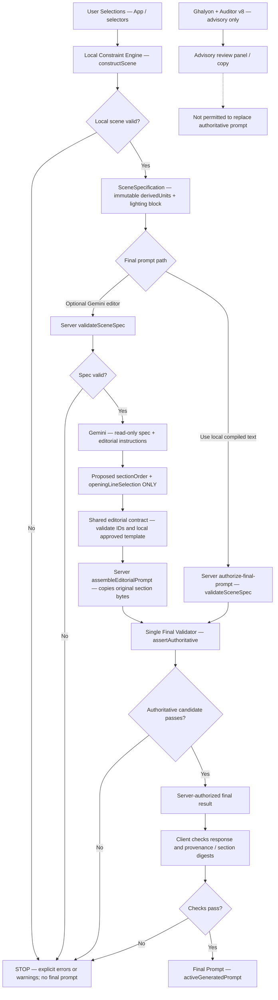

# Architecture — Bedroom Selfie MVP

The single authoritative scene is **constructed deterministically** from user selections. Gemini is an optional editor of an already constructed prompt, **not** a creative director, physical simulator, room rearranger or source of invented content.

## Mandatory architecture

```text
User Selections
  → Constraint Engine
  → SceneSpecification (single source of truth)
  → Gemini Prompt Editor (language only)
  → Final Validator
  → Final Prompt
```

The mandatory **authority boundary** applies equally when Gemini is skipped in favor of the local compiled prompt.



## Fail-closed behavior, one layer at a time

| Boundary | What is trusted | Fail-closed condition |
|---|---|---|
| User selections | Only explicitly chosen options; warnings never invent missing facts | Reject unknown preset and contradictory active camera/light; no silent selection corrections |
| Local Constraint Engine | `src/engine/scene-construction.ts` (stable `compilePrompt` facade) plus existing physics/geometry/renderers | Invalid scene returns errors with empty `promptText`, no fabricated fallback |
| SceneSpecification | `buildSceneSpecification` in `src/features/ai-prompt-enhancer/scene-specification.ts` | Missing/duplicate units, contradictory physical fields and invalid body/bedding contacts cannot be approved by `validateSceneSpec` |
| Lighting decision | `shared/lighting-decision.ts`: `activeLightSource`, `savedLightingPreference`, `savedLightingPreferenceActive` | In exclusive mode saved preference is **inactive** and visible; explicit second source is rejected; unknown ID is rejected |
| Gemini request | Only `{spec, editorialInstructions}` as read-only data | No image pixels, no direct physics instruction payload, no request for creative scene generation |
| Gemini response | Only `{sectionOrder, openingLineSelection}` | Extra prose or body fields, unknown/duplicate/missing section IDs, order-lock violations and nonapproved opening templates cause explicit errors |
| Local server reassembly | **One implementation:** `assembleEditorialPrompt` in `shared/editorial-contract.ts` | Every immutable section must be present exactly once, text byte-for-byte unchanged, and opening from the local allowlist |
| Final authority | **One policy function:** `assertAuthoritative` in `shared/authoritative-prompt.ts` | Reject advisory sources, free-text replacement, malformed or disguised candidates; never trust React state or model self-labeling as proof |
| Client verification | `validateConstrainedEditorReply` verifies SHA-256 prompt/section digests without assembling text; local authorization verifies server source, spec fingerprint and exact returned text | Failed verification is not promoted into `activeGeneratedPrompt` |
| Optional adviser tools | Ghalyon and Auditor v8 keep text generation, copy and review workflows | Always **Advisory Output — Non-Authoritative**; no path to Final Prompt without the same authority policy |
| Photo audit | `PhotoResultAudit.originalPrompt` comes from authorized result | No AI image audit with an unapproved prompt; manual local review remains available |

**Important distinction:** `SceneSpecification.integrity` uses deterministic FNV-1a for consistency and is not a cryptographic signature. SHA-256 digests check transport/consistency rather than prove a remote user's identity. The backend **revalidates the scene and exact output**, rather than relying on a client-supplied “validated” flag.

## PR1–PR4 ownership map

- **PR1 — Local construction boundary:** `src/engine/scene-construction.ts`; `src/compiler/index.ts` remains a stable facade. Pre-PR1 orchestration and repeat invocation are regression-tested.
- **PR2 — Exclusive lighting Option B:** `shared/lighting-decision.ts`, `src/engine/physical-reality.ts`; keeps saved preferences inactive while exclusive single-emitter modes are active. The server checks the lighting block; the UI visibly marks the preference inactive.
- **PR3 — Language-only editing:** `shared/editorial-contract.ts` for allowed IDs/local templates and immutable reconstruction; `api/generate-main-prompt.ts` for server assembly. The client does **not** contain a second assembly algorithm.
- **PR4 — Final authority:** `shared/authoritative-prompt.ts` defines the only authority policy; invoked by `api/generate-main-prompt.ts` and `api/authorize-final-prompt.ts`. Advisers retain their independent endpoints and behaviors but never write into the authoritative prompt channel.
- **PR5 — Document and no-logic-change rule relocation:** `shared/capture-lighting-rules.ts` holds the three exact comparisons formerly duplicated across preflight, local compiler checks and server scene validation.

## Canonical physics/mechanics/geometry rule owners

These modules have different responsibilities; semantically similar *rendering descriptions* are not duplicate executable logic.

| Rule owner | Purpose | Regression coverage |
|---|---|---|
| `shared/body-shot-postures.ts` | One canonical shot-to-posture mapping for browser/server | `src/tests/gemini-main.test.ts`, body mechanics suites |
| `shared/body-mechanics.ts` and `src/engine/body-mechanics.ts` adapter | Canonical support/contact/hand occupancy state and user option normalization | `src/tests/body-mechanics-v21.test.ts` |
| `shared/bedding-physics.ts` and `src/engine/bedding-physics.ts` adapter | Canonical body-contact-to-bedding response | `src/tests/bedding-physics-v22.test.ts` |
| `shared/lighting-decision.ts` | Normal/exclusive active light and inactive saved preference | `src/tests/lighting-option-b-pr2.test.tsx` |
| `shared/capture-lighting-rules.ts` | Three exact capture/light compatibility predicates CL-1–CL-3 | `src/tests/capture-lighting-rules-pr5.test.ts`, plus existing preflight and server suites |
| `src/engine/physical-reality.ts` | Active physical emitter calculation and exclusive-mode consistency | `src/tests/physical-reality.test.ts` |
| `src/data/mirror-optics-mechanics.ts` | Mirror optics/body mechanics *text contract* | `src/tests/mirror-optics-mechanics.test.ts` |
| `src/data/mirror-room-geometry.ts` | Reference-relative room geometry *text contract* | `src/tests/mirror-room-geometry.test.ts` |
| `src/compiler/final-realism.ts` | Local completeness checks for rendered sections | Existing compiler/mirror geometry tests |

### PR5 moved rules, exact truth tables (zero logic change)

Each rule's canonical function contains a comment pointing to `src/tests/capture-lighting-rules-pr5.test.ts`. The test loops over all registered shots/lights and relevant capture modes, comparing the moved predicate against **the exact prior condition**.

| Rule | Canonical predicate | Existing callers | Frozen prior condition |
|---|---|---|---|
| CL-1 | `mirrorRearFlashNeedsSource(shotId, lighting)` | UI preflight; local validation; final realism; server spec validation | `shotId === 'mirror_rear_flash' && lighting !== 'rear_flash'` |
| CL-2 | `captureAllowsRearFlash(mode)` | UI preflight; server spec validation | `mode === 'rear' || mode === 'mirror'` |
| CL-3 | `rearCaptureScreenOnlyConflict(mode, lighting)` | UI preflight; server spec validation | `lighting === 'phone_screen_only' && mode === 'rear'` |

All existing caller-specific error messages and **the server mirror-mode guard on CL-1** remain unchanged. The relocation changes function placement only and is deliberately separate from every PR2 lighting *policy* change.

## Non-goals and known limits

This program is a scene/prompt consistency engine, **not** image generation, a full 3D renderer, geometric ray tracer, physical force solver or proof that a photograph is genuine. Source photos are not sent to the Gemini text editor. Rendering success is outside the compiler's direct observation.

The physically similar descriptive passages in `mirror-optics-mechanics.ts` and `mirror-room-geometry.ts` support different text units and therefore remain separate in PR5; merging them could change byte-protected prompts. Do not interpret prose overlap as a reason to alter their validated outputs.

**Issue #59 — inter-section transitions and prompt readability — is explicitly deferred.** It must be tackled in a separate PR **after PR5 is merged**, with explicit approval and its own golden prompt comparisons.
